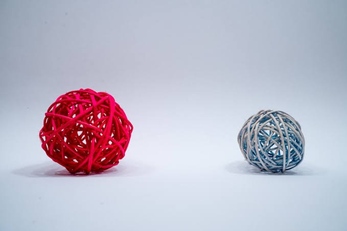
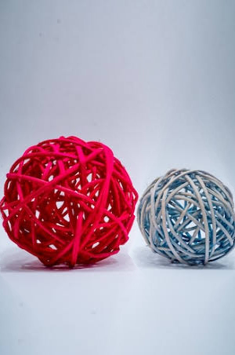

# Seam Carve

This is a website that will try to resize with content-awareness. Basically, it will try to resize without distorting the main contents of the image.

Most of this is based from [this article](https://doi.org/10.1145/1276377.1276390).

# Examples

| Original Image | After Seam Carving |
| :---: | :---: |
|  |  |
| *679 × 452 px* | *300 × 452 px* |
